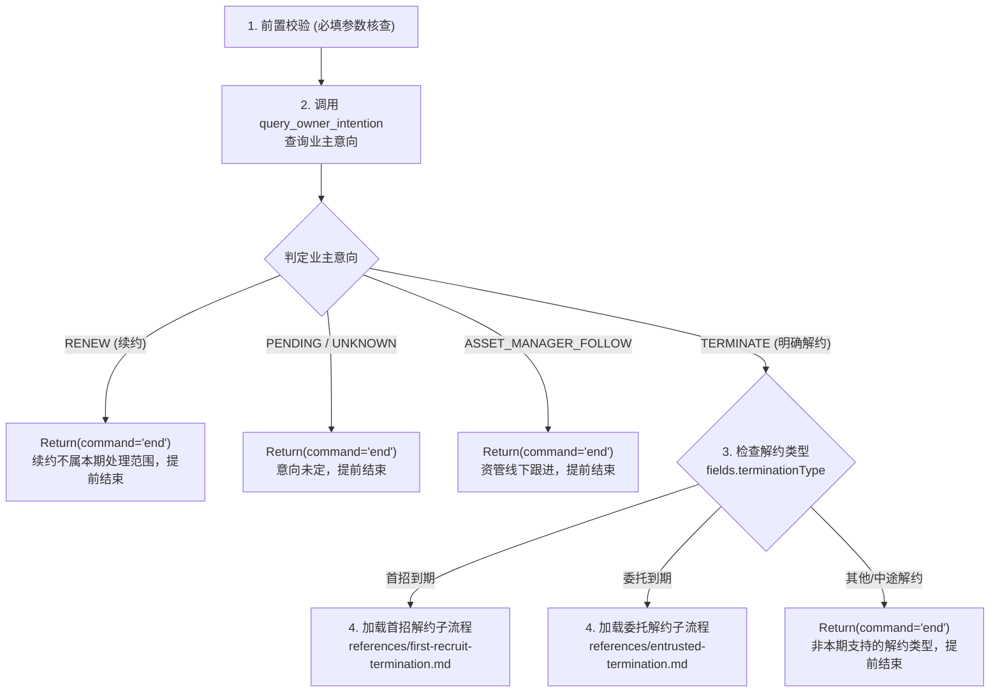

# 业主自助解约（owner-self-termination）

## 目标

本 Skill 处理首招到期和委托到期的解约起草发起：完成入口防重、业务前置核验和资管授权后，直接调用合同侧 `triggerAutoTermination`。起草成功返回 `command: null`，本轮结束，后续办理交工程侧。本期不执行起草后的合同结果查询、事件接续、催签或回访。

- **业务场景**：首招到期解约、委托到期解约。
- **业务边界**：本期明确**不处理续约流程**（若意向为续约则输出 `end` 提前结束任务），且**不处理中途解约**（如托管中途解约、首次招租中途解约）。

## 输入字段（Runtime Fields）

所有由外部上游宿主环境或调度器注入的运行时变量均归属在 `fields` 作用域下，在工作流程与工具调用参数中必须使用 `{{fields.xxx}}` 语法进行引用（例如：`orderId: {{fields.orderId}}`）。运行时字段为严格只读，严禁在执行中修改或伪造。

详细字段定义、取值语义与边界约束参见 [resources/runtime-fields.md](resources/runtime-fields.md)。

| 字段表达式 | 类型 | 必填 | 说明 |
| :--- | :--- | :---: | :--- |
| `{{fields.orderId}}` | Long | 是 | 续解业务协同工单 ID，用于意向查询与全流程工单串联 |
| `{{fields.contractCode}}` | String | 是 | 业主原收房合同编号（托管合同编号），用于协议防重与交割查询 |
| `{{fields.contractId}}` | Long | 是 | 大于 0 的业主原收房合同主键 ID，用于触发合同自动解约起草；与 `contractCode` 分别传入 |
| `{{fields.terminationType}}` | String | 是 | 解约类型描述，本期仅支持 `首招到期` 或 `委托到期` |
| `{{fields.backDate}}` | Date | 起草时必填 | 上游按合同 DTO 提供的还房日，统一业务时区当天零点，原样透传 |
| `{{fields.executionId}}` | Long | 否 | 业主解约推进事实记录 ID，有值时优先作为资管授权推进查询与催办的入参 |
| `{{fields.sessionId}}` | String | 否 | 会话链路追踪 ID，有值时原样透传给各工具 |
| `{{fields.requestId}}` | String | 否 | 请求链路追踪 ID，有值时原样透传给各工具 |

## 重要规则

1. **如何调用工具？**
   所有外部能力的调用均统一使用伪代码 `Call({ name: ..., payload: ... })` 表示。工具名称与参数字段名必须严格与 [resources/tool-contracts.md](resources/tool-contracts.md) 保持一致，严禁自行编造字段名或篡改入参语义。
   ```text
   Call({
     name: "query_owner_intention",
     payload: {
       orderId: {{fields.orderId}},
       sessionId: {{fields.sessionId}},
       requestId: {{fields.requestId}}
     }
   })
   ```

2. **如何在 Workflow 结束流程并返回值？**
   工作流在任何分支终止、等待调度、转交人工或执行完成时，统一使用伪代码 `Return({...})` 提交结果并结束执行。返回数据对象的结构必须严格遵循 [resources/output-scheme.md](resources/output-scheme.md) 规范，固定包含 `command`、`nextScheduleAt`、`finalAnswer`、`reason` 四个字段，与 `AgentLoopOutput` 协议对齐。
   - `command` 字段仅允许使用 `"schedule"`、`"transfer_to_human"`、`"end"` 或 `null`。
   - **工单流转与关单由工程侧统一收口**：模型无需调用任何关单工具，通过输出 `command: "end"` 触发工程侧统一处理。
   ```json
   Return({
     "command": "end",
     "nextScheduleAt": null,
     "finalAnswer": null,
     "reason": "业主意向为续约，不在本期自助解约处理范围，提前结束自动推进"
   })
   ```

3. **直接使用合同侧工具名称和 DTO**：
   入口防重沿用现有 `query_owner_termination_agreement` 及其原参数。发起起草直接调用合同侧 `triggerAutoTermination`，只传 `contractId/terminationType/backDate`，直接读取原生响应的 `autoApplyId/terminationContractId/applyStatus/currentNode`，不设置工具别名或 Draft 协议转换。起草工具待 Landlord 实现、注册，定义见 [tool-contracts.md](resources/tool-contracts.md#triggerautotermination)。

## 工作流程

以下步骤与两份 Reference SOP 只覆盖首次发起及起草前推进，执行到起草接口返回即结束本轮。



### 1. 前置校验必要运行参数

在执行任何业务逻辑与工具调用前，首先校验必要运行时参数的完整性：

1. 检查必填字段 `{{fields.orderId}}`、`{{fields.contractCode}}`、`{{fields.contractId}}`、`{{fields.terminationType}}` 是否均存在且非空；`contractId` 必须是大于 0 的 Long。`backDate` 在调用合同触发工具前校验。
2. 若任一必填字段缺失或为空，属于运行参数缺失异常，直接转交人工管家排查：
   ```json
   Return({
     "command": "transfer_to_human",
     "nextScheduleAt": null,
     "finalAnswer": null,
     "reason": "前置校验失败：缺失必填运行参数（orderId/contractCode/contractId/terminationType），转人工服务管家核验"
   })
   ```

### 2. 查询业主续解意向

调用意向查询工具，确认当前协同单中业主的真实意向：

```text
Call({
  name: "query_owner_intention",
  payload: {
    orderId: {{fields.orderId}},
    sessionId: {{fields.sessionId}},
    requestId: {{fields.requestId}}
  }
})
```

**决策分支与处理方式**：

- **明确解约（`intention == "TERMINATE"`）**：
  业主解约意向明确，进入第 3 步，检查解约类型并分流。

- **意向为续约（`intention == "RENEW"`）**：
  本期明确不处理续约。属于正常业务互斥，直接输出 `command: "end"` 提前结束自动推进，无需转人工：
  ```json
  Return({
    "command": "end",
    "nextScheduleAt": null,
    "finalAnswer": null,
    "reason": "业主意向为续约，不在本期自助解约处理范围，提前结束自动推进"
  })
  ```

- **待业主确认（`intention == "PENDING"`）或未知意向（`intention == "UNKNOWN"`）**：
  业主意向尚未确定，无法自动推进解约，输出 `command: "end"` 提前结束：
  ```json
  Return({
    "command": "end",
    "nextScheduleAt": null,
    "finalAnswer": null,
    "reason": "业主续解意向尚未明确确认，提前结束本次解约自动推进"
  })
  ```

- **资管跟进（`intention == "ASSET_MANAGER_FOLLOW"`）**：
  标记由资管人员线下自跟进，属于业务正常分流，输出 `command: "end"` 提前结束自动推进：
  ```json
  Return({
    "command": "end",
    "nextScheduleAt": null,
    "finalAnswer": null,
    "reason": "业主意向标记为资管线下自跟进，提前结束本次自动推进"
  })
  ```

### 3. 检查解约类型

在业主明确解约的前提下，根据运行时字段 `{{fields.terminationType}}` 进行业务场景校验：

- 若 `{{fields.terminationType}} == "首招到期"`：进入第 4 步，加载首招到期解约子流程。
- 若 `{{fields.terminationType}} == "委托到期"`：进入第 4 步，加载委托到期解约子流程。
- 若为其他值（例如 `"托管中途解约"`、`"首次招租中途解约"` 或未识别类型）：超出本期自动化处理范围，输出 `command: "end"` 提前结束任务：
  ```json
  Return({
    "command": "end",
    "nextScheduleAt": null,
    "finalAnswer": null,
    "reason": "当前解约类型不在本期自动化处理范围: " + {{fields.terminationType}} + "，提前结束本次自动推进"
  })
  ```

### 4. 根据解约类型加载对应流程

根据解约类型加载并执行对应的子流程文件。具体的前置合同校验、交割单核查、资管授权判定与解约协议起草等业务步骤，完全由对应的 Reference SOP 文件定义与执行：

- **当 `{{fields.terminationType}} == "首招到期"` 时**：
  加载并执行 [references/first-recruit-termination.md](references/first-recruit-termination.md)，由该子流程完成首招到期场景下的合同核验、资管授权判定与协议起草。

- **当 `{{fields.terminationType}} == "委托到期"` 时**：
  加载并执行 [references/entrusted-termination.md](references/entrusted-termination.md)，由该子流程完成委托到期场景下的交割与物损核验、合同冲突排查、资管授权判定与协议起草。

## 安全护栏（Guardrails）

1. **写操作安全与准入判定**：
   - 起草协议写接口（`triggerAutoTermination`）调用前必须满足全部前置条件：业主意向确认解约（`TERMINATE`）、资管明确同意（`AGREE_DRAFT`）、无在途冲突协议，且委托到期场景下租客交割已完成且无物损（`canProceedTermination == true`）。
   - 合同明确返回前置业务校验不通过或自动申请失败/人工终止时，按 [起草返回处理](resources/tool-contracts.md#起草返回处理) 输出 `end`，记录接口实际返回的原因及申请、节点信息；本期不追加失败详情查询，不编造原生响应未返回的原因。
   - 技术异常、未接入、超时或结果不确定不按业务校验失败处理。不得盲目重试起草；无法按工具契约确认结果或自动恢复时，输出 `command: "transfer_to_human"`，保留原始报错。具体异常及参数修正规则见 [resources/tool-contracts.md](resources/tool-contracts.md)。

2. **读操作异常分级治理**：
   - 参数非法（`errno == 1003`）：模型结合报错信息修正入参，**仅允许重试 1 次**；
   - 网络抖动 / 依赖服务超时（`errno == 1004`）：**仅允许重试 1 次**；若重试仍失败，判定系统不可用，输出 `command: "transfer_to_human"`，并在 `reason` 中保留底层报错；
   - 严禁对读操作接口进行无休止轮询重试。

3. **区分业务阻断与系统异常（严禁滥用转人工）**：
   - 遇到续约意向、房源在租、存在有效延长期等业务互斥情形，属于正常的业务排查事实，**必须输出 `command: "end"` 提前结束自动推进，严禁误报转人工**。
   - 资管授权的追问、等待、结束等业务处理，以对应子流程中的“资管授权意图识别与分发”章节为准。

4. **单据与会话流转由工程侧闭环**：
   - 模型端不调用任何关单工具或转人工工具；
   - 工程侧消费 `command: "end"` 或 `command: "transfer_to_human"` 后，按运行用途处理业务终止或人工接管；是否释放会话由工程侧契约决定，不能把业务结束等同于销毁 Agent 会话。
   - 起草成功后的 `command: null` 只结束本轮，不关闭推进单、不新增定时调度；后续合同办理由工程侧负责。

## 完成判定

1. **起草成功或申请执行中**：
   - `triggerAutoTermination` 返回有效 `autoApplyId`，且 `applyStatus=1/2` 时，输出 `command: null`、`nextScheduleAt: null`，不再调用合同查询，也不安排催签。
   - `applyStatus=1` 且 `terminationContractId` 非空时，允许通过群消息出口播报“协议已起草、后续办理中”；尚无协议 ID 时只能说明“申请已受理”。`applyStatus=2` 仅表示已发送业主，本 Skill 不处理签约通知或推断实际签署。
   ```json
   Return({
     "command": null,
     "nextScheduleAt": null,
     "finalAnswer": "@业主 您好，您的解约协议已起草，目前正在办理后续流程，请您耐心等待。",
     "reason": "起草成功，本轮结束，后续办理交工程侧"
   })
   ```
   不需要或不允许群发时，`finalAnswer=null`。工程侧持久化原生返回信息，后续结果处理不属于本期 Skill。

2. **业务阻断或发起失败**：
   - 入口查到已有有效解约协议、续约或在租等互斥条件时，输出 `end`，记录原因；合同原生响应的失败和人工终止也按“起草返回处理”结束本次发起。
   - `end` 表示本次发起任务结束，不代表合同已解约或业主已签署。
