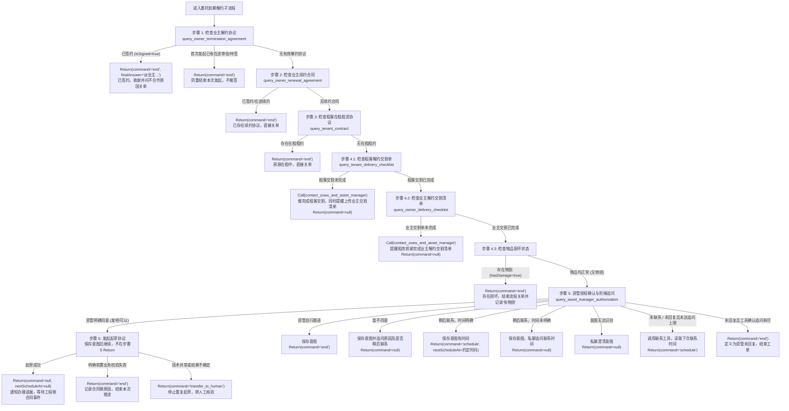

# 委托到期解约流程规范（Entrusted Termination SOP）

## 概述

本流程用于指导 Agent 处理**委托到期**（原收房委托合同到期）场景下的业主自助解约起草任务。

- **前置前提**：已通过主流程 [SKILL.md](../SKILL.md) 的运行时参数校验，且确认当前工单下业主意向为明确解约（`intention == "TERMINATE"`）。
- **处理目标**：依次执行原收房合同解约协议防重、续约合同排查、租客在租排查、租客与业主双重交割单完结及无物损核查、资管管家授权确认（含 2h/4h/t+1 阶梯式追问）及解约协议起草。起草成功后返回 `command: null`，按允许的群消息出口通知办理进展，等待工程侧合同事件；不在起草节点安排签约提醒。
- **返回契约**：所有流程结束与状态回传必须严格遵循 [resources/output-scheme.md](../resources/output-scheme.md) 规范。工单流转与关单由工程侧根据返回值统筹闭环。
- **执行范围**：本 SOP 用于首次发起及起草前推进。本次已起草成功后，合同事件唤醒应按 [合同事件接续规则](../SKILL.md#合同事件接续规则) 处理，不重新执行本 SOP 的入口防重，不重复起草。

---

## 依赖工具清单

本子流程依赖以下 10 个核心工具。字段与接入边界见 [resources/tool-contracts.md](../resources/tool-contracts.md)；合同触发和申请查询需按合同侧文档适配，授权查询的时间字段及新增意图保存工具待工程补齐。

| 序号 | 工具标识 (Tool Name) | 工具类型 | 用途说明 |
| :---: | :--- | :---: | :--- |
| 1 | [`query_owner_termination_agreement`](../resources/tool-contracts.md#query_owner_termination_agreement) | 读查询 | 起草前查询收房合同是否已有解约协议，避免重复起草 |
| 2 | [`query_owner_renewal_agreement`](../resources/tool-contracts.md#query_owner_renewal_agreement) | 读查询 | 查询当前收房合同是否已发起续约合同（续约互斥排查） |
| 3 | [`query_tenant_contract`](../resources/tool-contracts.md#query_tenant_contract) | 读查询 | 查询当前房源是否存在有效租客租赁合同（在租互斥排查） |
| 4 | [`query_tenant_delivery_checklist`](../resources/tool-contracts.md#query_tenant_delivery_checklist) | 读查询 | 查询上任租客退租交割完结状态及物损明细 |
| 5 | [`query_owner_delivery_checklist`](../resources/tool-contracts.md#query_owner_delivery_checklist) | 读查询 | 查询业主解约交割清单（还房单）完成状态及租务管家信息 |
| 6 | [`query_asset_manager_authorization`](../resources/tool-contracts.md#query_asset_manager_authorization) | 读查询 | 查询联系状态、资管授权意图及工具计算的下次联系时间 `nextContactAt` |
| 7 | [`contact_zuwu_and_asset_manager`](../resources/tool-contracts.md#contact_zuwu_and_asset_manager) | 写操作 | 私聊/工作通知租务管家催交割，或联系资管经理确认授权 |
| 8 | [`draft_owner_termination_agreement`](../resources/tool-contracts.md#draft_owner_termination_agreement) | 写操作 | 向合同系统发起起草业主解约协议请求 |
| 9 | `save_asset_manager_authorization`（暂定，待接入） | 写操作 | 保存识别到的资管意图、原因及可空的下次联系时间 |
| 10 | [`query_owner_termination_auto_apply`](../resources/tool-contracts.md#query_owner_termination_auto_apply)（目标 Tool，待注册） | 读查询 | 适配 `queryAutoTermination`，精确查询本次申请的状态及失败原因 |

---

## 业务流转图



---

## 详细执行步骤

### 步骤 1：检查业主解约协议（防重核查）

调用查询工具排查收房合同当前是否已有解约协议，避免重复发起：

```text
Call({
  name: "query_owner_termination_agreement",
  payload: {
    contractCode: {{fields.contractCode}},
    orderId: {{fields.orderId}},
    sessionId: {{fields.sessionId}},
    requestId: {{fields.requestId}}
  }
})
```

**决策分支**：
1. **已签约生效（`hasValidAgreement == true && isSigned == true`）**：
   原收房合同已完成解约协议签署，属于业务终态达成。通过 `finalAnswer` 向企微业主群发送签约办结与致谢消息，并询问不合作原因，输出 `command: "end"` 关单：
   ```json
   Return({
     "command": "end",
     "nextScheduleAt": null,
     "finalAnswer": "@业主 您好，您的房屋委托到期解约协议已确认签署完成，解约手续已全部办结。感谢您一直以来对我们的信任与支持，祝您生活愉快！请问本次不再合作的主要原因是什么呢？您的宝贵建议对我们至关重要。",
     "reason": "原收房合同解约协议已签署完成，发送服务合作致谢祝福及不合作原因回访，流程完结直接关单"
   })
   ```
2. **在途推进中（`hasValidAgreement == true && isSigned == false`）**：
   首次发起时已有正在审批或待签约的解约协议，避免重复起草，结束本次发起任务；此处不催业主签约。该分支不用于本次已起草成功后的合同事件恢复，不能用它结束原来正在等待事件的推进单：
   ```json
   Return({
     "command": "end",
     "nextScheduleAt": null,
     "finalAnswer": null,
     "reason": "首次发起发现原收房合同已有在途审批或待签署的解约协议，防重结束本次发起"
   })
   ```
3. **无有效协议（`hasValidAgreement == false`）**：进入步骤 2。

---

### 步骤 2：检查业主续约合同（互斥排查）

调用查询工具排查收房合同是否已存在续约合同：

```text
Call({
  name: "query_owner_renewal_agreement",
  payload: {
    contractCode: {{fields.contractCode}},
    orderId: {{fields.orderId}},
    sessionId: {{fields.sessionId}},
    requestId: {{fields.requestId}}
  }
})
```

**决策分支**：
1. **存在有效续约合同（`hasValidRenewal == true`）**：
   定义为“业主续约”，与解约流程互斥，直接关单：
   ```json
   Return({
     "command": "end",
     "nextScheduleAt": null,
     "finalAnswer": null,
     "reason": "房源已存在有效续约合同，定义为业主续约，直接关单"
   })
   ```
2. **无有效续约合同（`hasValidRenewal == false`）**：进入步骤 3。

---

### 步骤 3：检查租客在租租赁协议（在租互斥排查）

排查当前托管房源是否存在生效中出房租约：

```text
Call({
  name: "query_tenant_contract",
  payload: {
    contractCode: {{fields.contractCode}},
    orderId: {{fields.orderId}},
    sessionId: {{fields.sessionId}},
    requestId: {{fields.requestId}}
  }
})
```

**决策分支**：
1. **存在在租租客合同（`hasValidTenantContract == true`）**：
   出房租约在租中，定义为“租客续约/在租”，与解约流程互斥，直接关单：
   ```json
   Return({
     "command": "end",
     "nextScheduleAt": null,
     "finalAnswer": null,
     "reason": "托管房源仍处于在租状态或租客已续约，与解约流程互斥，直接关单"
   })
   ```
2. **无在租租客合同（`hasValidTenantContract == false`）**：进入步骤 4。

---

### 步骤 4：检查租客与业主解约交割单及物品损坏（实体验收核查）

本步联系租务时统一使用 `target: "ZUWU"`。当前工具契约未暴露私聊/客户微信群的渠道选择参数，Skill 不自行编造渠道字段；具体通知渠道由联系租务工具根据租务角色和业务上下文路由。

#### 4.1 检查租客退租交割单状态
调用工具核查租客解约交割单是否完成：
```text
Call({
  name: "query_tenant_delivery_checklist",
  payload: {
    contractCode: {{fields.contractCode}},
    orderId: {{fields.orderId}},
    sessionId: {{fields.sessionId}},
    requestId: {{fields.requestId}}
  }
})
```

- **租客交割未完成（`isDeliveryFinished == false`）**：
  调用 `contact_zuwu_and_asset_manager` 联系租务管家。本次联系必须同时表达两个要求：
  1. 抓紧完成租客退租解约交割；
  2. 抓紧上传并完成业主解约交割清单。

  ```text
  Call({
    name: "contact_zuwu_and_asset_manager",
    payload: {
      contractCode: {{fields.contractCode}},
      orderId: {{fields.orderId}},
      target: "ZUWU",
      contactReason: "租客交割未完成，催办租客交割及业主交割清单",
      content: "管家您好，该房源业主已明确到期解约，请抓紧完成租客退租解约交割，并同步上传、完成业主解约交割清单。",
      sessionId: {{fields.sessionId}},
      requestId: {{fields.requestId}}
    }
  })
  ```

  联系工具成功受理后结束本轮，不查询业主交割单，不继续进入物损核查或资管授权：

  ```json
  Return({
    "command": null,
    "nextScheduleAt": null,
    "finalAnswer": null,
    "reason": "租客解约交割未完成，已联系租务管家催办租客交割及业主交割清单，本轮不再继续后续流程"
  })
  ```

  > 当前边界：本阶段只根据“租客交割未完成”决定是否调用联系租务工具；不判断是否已提醒、当前是第几次提醒，也不在本节定义当天二次提醒的调度时机。

- **租客交割已完成（`isDeliveryFinished == true`）**：进入 4.2 业主交割单核查。

#### 4.2 检查业主解约交割单状态
调用工具查询省心租交还业主交割清单是否完成：
```text
Call({
  name: "query_owner_delivery_checklist",
  payload: {
    contractCode: {{fields.contractCode}},
    orderId: {{fields.orderId}},
    sessionId: {{fields.sessionId}},
    requestId: {{fields.requestId}}
  }
})
```

- **业主交割单未完成（`isDeliveryFinished == false`）**：
  调用 `contact_zuwu_and_asset_manager` 联系租务管家，提醒抓紧完成业主解约交割清单任务：
  ```text
  Call({
    name: "contact_zuwu_and_asset_manager",
    payload: {
      contractCode: {{fields.contractCode}},
      orderId: {{fields.orderId}},
      target: "ZUWU",
      contactReason: "催促完成业主解约交割清单上传",
      content: "管家您好，租客退租交割已完成，请抓紧完成业主解约交割清单（还房单）的上传与完结。",
      sessionId: {{fields.sessionId}},
      requestId: {{fields.requestId}}
    }
  })
  ```
  联系工具成功受理后结束本轮，不继续进入物损核查或资管授权：

  ```json
  Return({
    "command": null,
    "nextScheduleAt": null,
    "finalAnswer": null,
    "reason": "租客解约交割已完成，但业主解约交割清单未完成，已联系租务管家催办，本轮不再继续后续流程"
  })
  ```
- **业主交割单已完成（`isDeliveryFinished == true`）**：进入 4.3 物品损坏核查。

#### 4.3 检查物品损坏状态
综合检查租客及业主交割单中的物损字段（`hasDamage`）：
- **存在损坏（`hasDamage == true`）**：
  任务流程结束关单，记录“有物损”：
  ```json
  Return({
    "command": "end",
    "nextScheduleAt": null,
    "finalAnswer": null,
    "reason": "交割清单检查存在物品损坏，任务流程结束关单，记录有物损"
  })
  ```
- **物品均正常（`hasDamage == false`）**：准入通过，进入步骤 5。

---

### 步骤 5：资管授权意图识别与分发

查询资管联系状态及已保存的授权意图，结合当前对话理解资管意见，按下列分支执行工具调用和 `Return`。

```text
Call({
  name: "query_asset_manager_authorization",
  payload: {
    executionId: {{fields.executionId}},
    orderId: {{fields.orderId}},
    contractCode: {{fields.contractCode}},
    sessionId: {{fields.sessionId}},
    requestId: {{fields.requestId}}
  }
})
```

- `assetState` 表示联系进度，`authorization` 表示授权意图。未联系使用 `NOT_CONTACTED`，未回复使用 `WAITING_REPLY`；`UNKNOWN` 只表示意图未确定。
- 查询工具同时返回计算后的 `nextContactAt`，不新增独立时间查询工具。追问次数及联系时间由工程和工具维护，Skill 不自行计数、计算时间梯度或填写固定日期。
- 识别到有效意图时，先调用 `save_asset_manager_authorization` 保存 `authorization`、`reason` 和 `nextContactAt`，成功后再分发；未明确联系时间时保存 `null`。已保存且未变化的意图不必重复写入。保存工具的具体契约待工程接入，不能模拟保存成功。
- 本步骤只有 `command="end"` 才结束工单并销毁会话，其余 command 均挂起。暂不同意、等待澄清或等待联系时间时，按本节返回，不套用旧的“非同意统一转人工”规则。
- 本步骤的私聊通过 `contact_zuwu_and_asset_manager` 发送，`target="ASSET_MANAGER"`，`finalAnswer` 均为 `null`；同意后的业主群通知由步骤 6 输出。
- 以下按“保存意图 → 按需私聊 → Return”的顺序列出调用。通用上下文沿用查询工具；新增保存工具的输入为目标契约，待工程对齐。前置工具调用成功后才执行后续步骤和对应 `Return`，失败按工具异常处理，不能仅在 `reason` 中声称已保存或已追问。
- 下列 `saveResult`、`queryResult` 表示对应工具成功返回的业务数据。

**决策分支**：

1. **明确同意起草（如“发吧”“可以”，`authorization="AGREE_DRAFT"`）**：
   先保存识别到的授权意图：
   ```text
   Call({
     name: "save_asset_manager_authorization",
     payload: {
       executionId: {{fields.executionId}},
       authorization: "AGREE_DRAFT",
       reason: 从当前对话提取的同意起草结论及原因,
       nextContactAt: null,
       sessionId: {{fields.sessionId}},
       requestId: {{fields.requestId}}
     }
   })
   ```
   保存成功后进入步骤 6 起草协议，本步骤不提前 `Return`。首次咨询应询问是否同意起草，不能在起草前声称协议已起草完毕。

2. **暂不同意（如“别发”“不能发”，`authorization="DECLINE_DRAFT"`）**：
   保存意图，调用联系工具追问尚未明确的原因及是否需要稍后联系；已经说明的内容不重复询问。暂不同意不直接关单，也不默认转人工：
   ```text
   Call({
     name: "save_asset_manager_authorization",
     payload: {
       executionId: {{fields.executionId}},
       authorization: "DECLINE_DRAFT",
       reason: 资管已说明的暂不同意原因或"原因待澄清",
       nextContactAt: null,
       sessionId: {{fields.sessionId}},
       requestId: {{fields.requestId}}
     }
   })
   Call({
     name: "contact_zuwu_and_asset_manager",
     payload: {
       executionId: {{fields.executionId}},
       orderId: {{fields.orderId}},
       contractCode: {{fields.contractCode}},
       target: "ASSET_MANAGER",
       contactReason: "确认暂不同意起草的原因及是否稍后联系",
       content: "收到，暂不发起起草。请问具体原因是什么？后续是否需要在指定时间再联系您确认？",
       sessionId: {{fields.sessionId}},
       requestId: {{fields.requestId}}
     }
   })
   ```
   私聊正文按尚缺的信息调整，随后返回：
   ```json
   Return({
     "command": null,
     "nextScheduleAt": null,
     "finalAnswer": null,
     "reason": "资管暂不同意起草，已追问原因及是否需要稍后联系，等待资管回复"
   })
   ```

3. **资管自行跟进（如“我跟进吧”“你别管了”，`authorization="ASSET_MANAGER_FOLLOW"`）**：
   保存意图及具体原因，定义为“资管跟进处理”，结束工单：
   ```text
   Call({
     name: "save_asset_manager_authorization",
     payload: {
       executionId: {{fields.executionId}},
       authorization: "ASSET_MANAGER_FOLLOW",
       reason: 从实际回复提取的资管自行跟进结论及具体原因,
       nextContactAt: null,
       sessionId: {{fields.sessionId}},
       requestId: {{fields.requestId}}
     }
   })
   ```
   ```json
   Return({
     "command": "end",
     "nextScheduleAt": null,
     "finalAnswer": null,
     "reason": "资管明确表示自行跟进处理，结束本次工单"
   })
   ```
   若资管说明了具体原因，将其补充到 `reason` 中。

4. **稍后联系（`authorization="CONTACT_LATER"`）**：
   - **联系时间明确**：保存意图和约定时间，将保存或查询工具返回的归一化时间原样填入 `nextScheduleAt`：
     ```text
     saveResult = Call({
       name: "save_asset_manager_authorization",
       payload: {
         executionId: {{fields.executionId}},
         authorization: "CONTACT_LATER",
         reason: 从实际回复提取的稍后联系原因及时间约定,
         nextContactAt: 根据资管明确约定得到的带时区绝对时间,
         sessionId: {{fields.sessionId}},
         requestId: {{fields.requestId}}
       }
     })
     Return({
       command: "schedule",
       nextScheduleAt: saveResult.nextContactAt,
       finalAnswer: null,
       reason: "资管要求稍后联系，按约定时间再次确认"
     })
     ```
   - **联系时间未明确**：先保存意图，时间留空，再调用联系工具询问具体日期和时刻，挂起等待回复：
     ```text
     Call({
       name: "save_asset_manager_authorization",
       payload: {
         executionId: {{fields.executionId}},
         authorization: "CONTACT_LATER",
         reason: 从实际回复提取的稍后联系结论或原因,
         nextContactAt: null,
         sessionId: {{fields.sessionId}},
         requestId: {{fields.requestId}}
       }
     })
     Call({
       name: "contact_zuwu_and_asset_manager",
       payload: {
         executionId: {{fields.executionId}},
         orderId: {{fields.orderId}},
         contractCode: {{fields.contractCode}},
         target: "ASSET_MANAGER",
         contactReason: "确认资管要求稍后联系的具体时间",
         content: "好的，请问您希望在哪一天、几点再次联系您确认？",
         sessionId: {{fields.sessionId}},
         requestId: {{fields.requestId}}
       }
     })
     ```
     ```json
     Return({
       "command": null,
       "nextScheduleAt": null,
       "finalAnswer": null,
       "reason": "资管要求稍后联系，但未明确联系时间，已追问并等待回复"
     })
     ```

5. **未识别到有效意图**：
   调用联系工具引导资管澄清，例如“请问您是同意起草、暂不同意、由您自行跟进，还是需要稍后再联系？”。不将无法识别的回复强行保存为同意、拒绝或 `OTHER_RESULT`：
   ```text
   Call({
     name: "contact_zuwu_and_asset_manager",
     payload: {
       executionId: {{fields.executionId}},
       orderId: {{fields.orderId}},
       contractCode: {{fields.contractCode}},
       target: "ASSET_MANAGER",
       contactReason: "澄清资管对起草解约协议的授权意图",
       content: "请问您是同意起草、暂不同意、由您自行跟进，还是需要稍后再联系？",
       sessionId: {{fields.sessionId}},
       requestId: {{fields.requestId}}
     }
   })
   ```
   ```json
   Return({
     "command": null,
     "nextScheduleAt": null,
     "finalAnswer": null,
     "reason": "暂未识别到明确资管意图，已发送澄清问题，等待资管回复"
   })
   ```

6. **未联系或资管未回复**：
   - **`NOT_CONTACTED`**：调用联系工具发送初次咨询，再通过授权查询工具取得下次联系时间，返回 `schedule`，`reason="等待资管回复"`。
     ```text
     Call({
       name: "contact_zuwu_and_asset_manager",
       payload: {
         executionId: {{fields.executionId}},
         orderId: {{fields.orderId}},
         contractCode: {{fields.contractCode}},
         target: "ASSET_MANAGER",
         contactReason: "咨询委托到期是否同意起草解约协议",
         content: "资管经理您好，该房屋委托到期，相关前置排查已通过，请问是否同意起草解约协议？审核通过后将按流程发送业主签约。",
         sessionId: {{fields.sessionId}},
         requestId: {{fields.requestId}}
       }
     })
     ```
   - **`WAITING_REPLY` 且工具返回下一次联系时间**：按本轮联系安排调用工具追问，再读取工具返回的下一次时间挂起。`nextScheduleAt` 使用工具提供的有效未来时间；`reason` 记录“资管未回复，等待资管回复”。
     ```text
     Call({
       name: "contact_zuwu_and_asset_manager",
       payload: {
         executionId: {{fields.executionId}},
         orderId: {{fields.orderId}},
         contractCode: {{fields.contractCode}},
         target: "ASSET_MANAGER",
         contactReason: "资管未回复，追问是否同意起草解约协议",
         content: "资管经理您好，之前咨询的委托到期解约协议起草事项尚未收到您的确认，请问您是否同意起草，或需要由您跟进、稍后再联系？",
         sessionId: {{fields.sessionId}},
         requestId: {{fields.requestId}}
       }
     })
     ```

   初次咨询或未回复追问的联系工具调用成功后，都重新查询下次联系时间；返回有效未来时间时执行下面的 `schedule`，明确追问耗尽时使用下方的 `end` 分支：

     ```text
     queryResult = Call({
       name: "query_asset_manager_authorization",
       payload: {
         executionId: {{fields.executionId}},
         orderId: {{fields.orderId}},
         contractCode: {{fields.contractCode}},
         sessionId: {{fields.sessionId}},
         requestId: {{fields.requestId}}
       }
     })
     Return({
       command: "schedule",
       nextScheduleAt: queryResult.nextContactAt,
       finalAnswer: null,
       reason: "等待资管回复"
     })
     ```

   - **`WAITING_REPLY` 且查询工具明确确认三次追问耗尽，`nextContactAt=null`**：定义为“资管未回复”，结束工单：
     ```json
     Return({
       "command": "end",
       "nextScheduleAt": null,
       "finalAnswer": null,
       "reason": "资管经理经3次追问仍未回复，定义为资管未回复，结束本次工单"
     })
     ```
   查询失败或字段缺失不表示追问耗尽；稍后联系但时间未明也不能按此分支结束。

所有 `Return` 均包含 `command`、`nextScheduleAt`、`finalAnswer`、`reason` 四个字段。非 `schedule` 时 `nextScheduleAt=null`，澄清及等待分支使用真正的 JSON `null`，不写字符串 `"null"`。

---

### 步骤 6：发起起草业主解约协议（写操作）

拿到资管确认结论后，调用 Tool 适配合同侧 `triggerAutoTermination`。先检查上游已提供有效的 `{{fields.backDate}}`（`yyyy-MM-dd`），缺失或格式非法时不调用写接口，返回 `transfer_to_human` 说明原因。委托到期使用合同侧 `terminationType: 1`；适配层将还房日转为统一业务时区当天零点的 `java.util.Date`。

```text
draftResult = Call({
  name: "draft_owner_termination_agreement",
  payload: {
    contractId: {{fields.contractId}},
    terminationType: 1,
    backDate: {{fields.backDate}}
  }
})
```

**决策分支**：
1. **已生成协议且继续办理（有效 `data.autoApplyId`、`data.applyStatus == 1` 且 `data.terminationContractId` 非空有效）**：
   返回 `command: null`、`nextScheduleAt: null` 结束本轮，等待工程侧投递合同后续事件。需要且允许群发时，通过 `finalAnswer` 播报办理进展；否则 `finalAnswer` 为 `null`：
   ```json
   Return({
     "command": null,
     "nextScheduleAt": null,
     "finalAnswer": "@业主 您好，您的委托到期解约协议已起草，目前正在办理后续流程，请您耐心等待。可签署时会再通知您。",
     "reason": "委托解约协议起草成功，本轮结束，等待工程侧投递合同后续事件"
   })
   ```
   工程侧持久化申请关联和当前阶段，后续事件按当前进度接续。此时不催签、不安排 t+2/t+3 调度、不再次查询协议或发起起草；发送业主完成后的通知及签署结果处理，遵循主 Skill 的合同事件接续规则。

2. **申请失败（`data.applyStatus == 3`）**：
   先按本次申请 ID 查询详情，不把调用正常返回当作业务成功，也不固定依赖网关错误码 `1007`：
   ```text
   queryResult = Call({
     name: "query_owner_termination_auto_apply",
     payload: { autoApplyId: draftResult.data.autoApplyId }
   })
   ```
   查询确认 `applyStatus=3`、`terminationContractId=null`、处于准备/起草节点，且 `reasonCode=1/2` 明确为前置业务校验失败时，不重试，输出 `command: "end"`，由工程侧结束本次推进。`reason` 必须包含查询返回的实际原因，不自动改还房日；例如：
   ```json
   Return({
     "command": "end",
     "nextScheduleAt": null,
     "finalAnswer": null,
     "reason": "合同起草前置业务校验不通过：待账单支付成功后再发起解约"
   })
   ```

3. **其他状态、技术异常或结果不确定**：
   统一按 [自动申请结果处理](../resources/tool-contracts.md#自动申请结果处理) 分流：`applyStatus=1` 但尚无协议 ID 时返回 `null` 等待，只能播报“申请已受理”；`2` 进入工程侧发送完成通知分支；`4` 停止自动办理、转人工。查询确认的审核驳回、执行失败或无法确认结果的异常保留原因转人工，不笼统 `end`。

   触发超时且没有申请 ID 时，先调用申请查询工具，只传 `contractId: {{fields.contractId}}`；已知申请 ID 时只传 `autoApplyId`。两者恰传一个，不能盲目重复起草。查询仍无法确认时：
   ```json
   Return({
     "command": "transfer_to_human",
     "nextScheduleAt": null,
     "finalAnswer": "@业主 您好，系统办理过程中出现微小异常，已为您转接人工服务管家跟进处理，请稍候。",
     "reason": "合同起草接口技术异常或结果不确定，停止重复起草，转人工服务管家核验"
   })
   ```

---

## 状态与返回值汇总对照表

| 步骤 | 命中条件 | 返回 Command | nextScheduleAt | finalAnswer | 核心处理语义 |
| :---: | :--- | :---: | :---: | :---: | :--- |
| **1. 解约防重** | `hasValidAgreement && isSigned` | `end` | `null` | `@业主 致谢+问原因` | 已签约完成，办结关单 |
|  | 首次发起时 `hasValidAgreement && !isSigned` | `end` | `null` | `null` | 防重结束本次发起；合同事件恢复不走此分支 |
| **2. 续约冲突** | `hasValidRenewal` | `end` | `null` | `null` | 定义为“业主续约”，直接关单 |
| **3. 在租冲突** | `hasValidTenantContract` | `end` | `null` | `null` | 定义为“租客续约/在租”，直接关单 |
| **4. 交割核查** | 租客交割未完 | `null` | `null` | `null` | 调用联系租务工具，同时催租客交割和业主交割清单；不判断提醒轮次 |
|  | 租客交割已完、业主交割单未完 | `null` | `null` | `null` | 调用联系租务工具，催完成业主交割清单 |
|  | 存在物损 (`hasDamage=true`) | `end` | `null` | `null` | 存在物损，任务流程结束关单记录有物损 |
| **5. 资管意图分发** | 明确同意起草 | 进第 6 步 | - | 本步骤不发群消息 | 保存意图后继续起草 |
|  | 暂不同意 | `null` | `null` | `null` | 保存意图，追问原因及是否稍后联系 |
|  | 资管自行跟进 | `end` | `null` | `null` | 保存意图和具体原因，结束工单 |
|  | 稍后联系，时间明确 | `schedule` | 工具返回的约定时间 | `null` | 保存意图及联系时间，挂起等待 |
|  | 稍后联系，时间未明确 | `null` | `null` | `null` | 保存意图，追问具体联系时间 |
|  | 无法识别有效意图 | `null` | `null` | `null` | 私聊澄清，等待回复 |
|  | 未联系 / 未回复且未达追问上限 | `schedule` | 授权查询工具返回时间 | `null` | 联系资管，等待回复；次数和时间由工具维护 |
|  | 未回复且工具确认三次追问耗尽 | `end` | `null` | `null` | 定义为“资管未回复”，结束工单 |
| **6. 协议起草** | `applyStatus=1`、有效申请 ID、协议 ID 非空 | `null` | `null` | 允许群发时播报办理进展，否则 `null` | 本轮结束，等待工程侧合同事件；不安排催签 |
|  | `applyStatus=3` 且查询确认前置业务校验失败 | `end` | `null` | `null` | 记录查询返回原因，结束本次推进 |
|  | 技术异常或结果不确定 | `transfer_to_human` | `null` | `@业主 转人工...` | 不盲目重试，转人工核验 |
