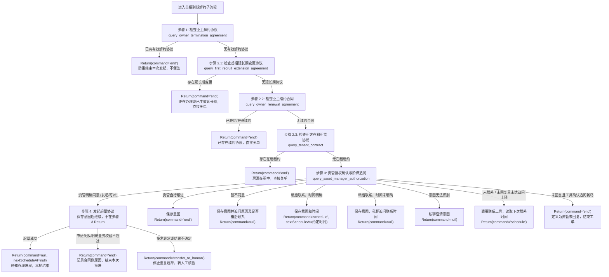

# 首招到期解约流程规范（First Recruit Termination SOP）

## 概述

本流程用于指导 Agent 处理**首招到期**（首次招租到期 / 招租延长期到期）场景下的业主自助解约起草任务。

- **前置前提**：已通过主流程 [SKILL.md](../SKILL.md) 的运行时参数校验，且确认当前工单下业主意向为明确解约（`intention == "TERMINATE"`）。
- **处理目标**：依次执行原收房合同解约协议防重、首招延长期变更协议排查、续约合同排查、租客在租排查、资管管家授权确认（含 2h/4h/t+1 阶梯式追问）及解约协议起草。起草成功后返回 `command: null`，按允许的群消息出口通知办理进展，本轮结束；不在起草节点安排签约提醒。
- **返回契约**：所有流程结束与状态回传必须严格遵循 [resources/output-scheme.md](../resources/output-scheme.md) 规范。工单流转与关单由工程侧根据返回值统筹闭环。
- **执行范围**：本 SOP 只负责入口防重、前置核验及发起起草。起草接口返回后结束本轮，不查询后续合同结果，不处理合同事件、催签或回访。

---

## 依赖工具清单

本子流程依赖以下 8 个核心工具。字段与接入边界见 [resources/tool-contracts.md](../resources/tool-contracts.md)；起草工具直接沿用合同侧名称和 DTO，待 Landlord 实现注册；入口查询沿用既有工具，授权查询的时间字段及新增意图保存工具待工程补齐。

| 序号 | 工具标识 (Tool Name) | 工具类型 | 用途说明 |
| :---: | :--- | :---: | :--- |
| 1 | [`query_owner_termination_agreement`](../resources/tool-contracts.md#query_owner_termination_agreement) | 读查询 | 沿用既有工具，查询是否已有有效解约协议，避免重复起草 |
| 2 | [`query_first_recruit_extension_agreement`](../resources/tool-contracts.md#query_first_recruit_extension_agreement) | 读查询 | 查询原合同是否存在首招延长期变更确认/协议（延长期排查） |
| 3 | [`query_owner_renewal_agreement`](../resources/tool-contracts.md#query_owner_renewal_agreement) | 读查询 | 查询原合同是否已发起续约合同（续约互斥排查） |
| 4 | [`query_tenant_contract`](../resources/tool-contracts.md#query_tenant_contract) | 读查询 | 查询当前房源是否存在有效租客租赁合同（在租互斥排查） |
| 5 | [`query_asset_manager_authorization`](../resources/tool-contracts.md#query_asset_manager_authorization) | 读查询 | 查询联系状态、资管授权意图及工具计算的下次联系时间 `nextContactAt` |
| 6 | [`contact_zuwu_and_asset_manager`](../resources/tool-contracts.md#contact_zuwu_and_asset_manager) | 写操作 | 私聊资管经理（咨询授权/2h/4h/t+1 追问及拒绝追问原因） |
| 7 | [`triggerAutoTermination`](../resources/tool-contracts.md#triggerautotermination) | 写操作 | 向合同系统发起起草首招到期业主解约协议请求 |
| 8 | `save_asset_manager_authorization`（暂定，待接入） | 写操作 | 保存识别到的资管意图、原因及可空的下次联系时间 |

---

## 业务流转图



---

## 详细执行步骤

### 步骤 1：检查业主解约协议（入口防重）

沿用现有 `query_owner_termination_agreement` 工具及原参数：

```text
agreementResult = Call({
  name: "query_owner_termination_agreement",
  payload: {
    contractCode: {{fields.contractCode}},
    orderId: {{fields.orderId}},
    sessionId: {{fields.sessionId}},
    requestId: {{fields.requestId}}
  }
})
```

- **查询成功且 `data.hasValidAgreement == true`**：已有有效解约协议，不重复发起起草；返回 `end`、`nextScheduleAt=null`、`finalAnswer=null`，记录协议现状。不论已签约还是在途，本期均不发送催签、致谢或回访消息。
- **查询成功且 `data.hasValidAgreement == false`**：进入步骤 2。
- **查询异常、空响应或字段不明确**：不能当作无协议放行，按读操作异常规则处理，仍无法确认时转人工。

---

### 步骤 2：合同与延长期冲突排查

在【合同到期日+1天】系统依次校验是否存在首招延长期变更协议、业主续约协议、租客在租租赁协议。

#### 2.1 检查首招延长期变更协议
调用工具排查原合同是否存在有效或在途延长期变更：
```text
Call({
  name: "query_first_recruit_extension_agreement",
  payload: {
    contractCode: {{fields.contractCode}},
    orderId: {{fields.orderId}},
    sessionId: {{fields.sessionId}},
    requestId: {{fields.requestId}}
  }
})
```
- **存在有效或在途延长期变更（`hasValidExtension == true`）**：
  原收房合同已办理或正在推进延长期，不可按到期解约，直接关单：
  ```json
  Return({
    "command": "end",
    "nextScheduleAt": null,
    "finalAnswer": null,
    "reason": "原收房合同已办理或正在推进首招延长期变更，不可按到期解约，直接关单"
  })
  ```
- **无延长期协议（`hasValidExtension == false`）**：进入 2.2。

#### 2.2 检查业主续约协议
调用工具排查原合同是否存在续约协议：
```text
Call({
  name: "query_owner_renewal_agreement",
  payload: {
    contractCode: {{fields.contractCode}},
    orderId: {{fields.orderId}},
    sessionId: {{fields.sessionId}},
    requestId: {{fields.requestId}}
  }
})
```
- **存在续约协议（`hasValidRenewal == true`）**：定义为“业主续约”，直接关单（`command: "end"`）。
- **无续约合同（`hasValidRenewal == false`）**：进入 2.3。

#### 2.3 检查租客在租租赁协议
调用工具排查是否存在生效中的租客租赁协议：
```text
Call({
  name: "query_tenant_contract",
  payload: {
    contractCode: {{fields.contractCode}},
    orderId: {{fields.orderId}},
    sessionId: {{fields.sessionId}},
    requestId: {{fields.requestId}}
  }
})
```
- **存在在租租约（`hasValidTenantContract == true`）**：定义为“租客续约/在租”，直接关单（`command: "end"`）。
- **无在租租约（`hasValidTenantContract == false`）**：排查通过，进入步骤 3。

---

### 步骤 3：资管授权意图识别与分发

查询资管联系状态及已保存的授权意图，结合当前对话理解资管意见，按下列分支执行工具调用和 `Return`。

```text
Call({
  name: "query_asset_manager_authorization",
  payload: {
    executionId: {{fields.executionId}},
    orderId: {{fields.orderId}},
    contractCode: {{fields.contractCode}},
    sessionId: {{fields.sessionId}},
    requestId: {{fields.requestId}}
  }
})
```

- `assetState` 表示联系进度，`authorization` 表示授权意图。未联系使用 `NOT_CONTACTED`，未回复使用 `WAITING_REPLY`；`UNKNOWN` 只表示意图未确定。
- 查询工具同时返回计算后的 `nextContactAt`，不新增独立时间查询工具。追问次数及联系时间由工程和工具维护，Skill 不自行计数、计算时间梯度或填写固定日期。
- 识别到有效意图时，先调用 `save_asset_manager_authorization` 保存 `authorization`、`reason` 和 `nextContactAt`，成功后再分发；未明确联系时间时保存 `null`。已保存且未变化的意图不必重复写入。保存工具的具体契约待工程接入，不能模拟保存成功。
- 本步骤只有 `command="end"` 才结束工单并销毁会话，其余 command 均挂起。暂不同意、等待澄清或等待联系时间时，按本节返回，不套用旧的“非同意统一转人工”规则。
- 本步骤的私聊通过 `contact_zuwu_and_asset_manager` 发送，`target="ASSET_MANAGER"`，`finalAnswer` 均为 `null`；同意后的业主群通知由步骤 4 输出。
- 以下按“保存意图 → 按需私聊 → Return”的顺序列出调用。通用上下文沿用查询工具；新增保存工具的输入为目标契约，待工程对齐。前置工具调用成功后才执行后续步骤和对应 `Return`，失败按工具异常处理，不能仅在 `reason` 中声称已保存或已追问。
- 下列 `saveResult`、`queryResult` 表示对应工具成功返回的业务数据。

**决策分支**：

1. **明确同意起草（如“发吧”“可以”，`authorization="AGREE_DRAFT"`）**：
   先保存识别到的授权意图：
   ```text
   Call({
     name: "save_asset_manager_authorization",
     payload: {
       executionId: {{fields.executionId}},
       authorization: "AGREE_DRAFT",
       reason: 从当前对话提取的同意起草结论及原因,
       nextContactAt: null,
       sessionId: {{fields.sessionId}},
       requestId: {{fields.requestId}}
     }
   })
   ```
   保存成功后进入步骤 4 起草协议，本步骤不提前 `Return`。首次咨询应询问是否同意起草，不能在起草前声称协议已起草完毕。

2. **暂不同意（如“别发”“不能发”，`authorization="DECLINE_DRAFT"`）**：
   保存意图，调用联系工具追问尚未明确的原因及是否需要稍后联系；已经说明的内容不重复询问。暂不同意不直接关单，也不默认转人工：
   ```text
   Call({
     name: "save_asset_manager_authorization",
     payload: {
       executionId: {{fields.executionId}},
       authorization: "DECLINE_DRAFT",
       reason: 资管已说明的暂不同意原因或"原因待澄清",
       nextContactAt: null,
       sessionId: {{fields.sessionId}},
       requestId: {{fields.requestId}}
     }
   })
   Call({
     name: "contact_zuwu_and_asset_manager",
     payload: {
       executionId: {{fields.executionId}},
       orderId: {{fields.orderId}},
       contractCode: {{fields.contractCode}},
       target: "ASSET_MANAGER",
       contactReason: "确认暂不同意起草的原因及是否稍后联系",
       content: "收到，暂不发起起草。请问具体原因是什么？后续是否需要在指定时间再联系您确认？",
       sessionId: {{fields.sessionId}},
       requestId: {{fields.requestId}}
     }
   })
   ```
   私聊正文按尚缺的信息调整，随后返回：
   ```json
   Return({
     "command": null,
     "nextScheduleAt": null,
     "finalAnswer": null,
     "reason": "资管暂不同意起草，已追问原因及是否需要稍后联系，等待资管回复"
   })
   ```

3. **资管自行跟进（如“我跟进吧”“你别管了”，`authorization="ASSET_MANAGER_FOLLOW"`）**：
   保存意图及具体原因，定义为“资管跟进处理”，结束工单：
   ```text
   Call({
     name: "save_asset_manager_authorization",
     payload: {
       executionId: {{fields.executionId}},
       authorization: "ASSET_MANAGER_FOLLOW",
       reason: 从实际回复提取的资管自行跟进结论及具体原因,
       nextContactAt: null,
       sessionId: {{fields.sessionId}},
       requestId: {{fields.requestId}}
     }
   })
   ```
   ```json
   Return({
     "command": "end",
     "nextScheduleAt": null,
     "finalAnswer": null,
     "reason": "资管明确表示自行跟进处理，结束本次工单"
   })
   ```
   若资管说明了具体原因，将其补充到 `reason` 中。

4. **稍后联系（`authorization="CONTACT_LATER"`）**：
   - **联系时间明确**：保存意图和约定时间，将保存或查询工具返回的归一化时间原样填入 `nextScheduleAt`：
     ```text
     saveResult = Call({
       name: "save_asset_manager_authorization",
       payload: {
         executionId: {{fields.executionId}},
         authorization: "CONTACT_LATER",
         reason: 从实际回复提取的稍后联系原因及时间约定,
         nextContactAt: 根据资管明确约定得到的带时区绝对时间,
         sessionId: {{fields.sessionId}},
         requestId: {{fields.requestId}}
       }
     })
     Return({
       command: "schedule",
       nextScheduleAt: saveResult.nextContactAt,
       finalAnswer: null,
       reason: "资管要求稍后联系，按约定时间再次确认"
     })
     ```
   - **联系时间未明确**：先保存意图，时间留空，再调用联系工具询问具体日期和时刻，挂起等待回复：
     ```text
     Call({
       name: "save_asset_manager_authorization",
       payload: {
         executionId: {{fields.executionId}},
         authorization: "CONTACT_LATER",
         reason: 从实际回复提取的稍后联系结论或原因,
         nextContactAt: null,
         sessionId: {{fields.sessionId}},
         requestId: {{fields.requestId}}
       }
     })
     Call({
       name: "contact_zuwu_and_asset_manager",
       payload: {
         executionId: {{fields.executionId}},
         orderId: {{fields.orderId}},
         contractCode: {{fields.contractCode}},
         target: "ASSET_MANAGER",
         contactReason: "确认资管要求稍后联系的具体时间",
         content: "好的，请问您希望在哪一天、几点再次联系您确认？",
         sessionId: {{fields.sessionId}},
         requestId: {{fields.requestId}}
       }
     })
     ```
     ```json
     Return({
       "command": null,
       "nextScheduleAt": null,
       "finalAnswer": null,
       "reason": "资管要求稍后联系，但未明确联系时间，已追问并等待回复"
     })
     ```

5. **未识别到有效意图**：
   调用联系工具引导资管澄清，例如“请问您是同意起草、暂不同意、由您自行跟进，还是需要稍后再联系？”。不将无法识别的回复强行保存为同意、拒绝或 `OTHER_RESULT`：
   ```text
   Call({
     name: "contact_zuwu_and_asset_manager",
     payload: {
       executionId: {{fields.executionId}},
       orderId: {{fields.orderId}},
       contractCode: {{fields.contractCode}},
       target: "ASSET_MANAGER",
       contactReason: "澄清资管对起草解约协议的授权意图",
       content: "请问您是同意起草、暂不同意、由您自行跟进，还是需要稍后再联系？",
       sessionId: {{fields.sessionId}},
       requestId: {{fields.requestId}}
     }
   })
   ```
   ```json
   Return({
     "command": null,
     "nextScheduleAt": null,
     "finalAnswer": null,
     "reason": "暂未识别到明确资管意图，已发送澄清问题，等待资管回复"
   })
   ```

6. **未联系或资管未回复**：
   - **`NOT_CONTACTED`**：调用联系工具发送初次咨询，再通过授权查询工具取得下次联系时间，返回 `schedule`，`reason="等待资管回复"`。
     ```text
     Call({
       name: "contact_zuwu_and_asset_manager",
       payload: {
         executionId: {{fields.executionId}},
         orderId: {{fields.orderId}},
         contractCode: {{fields.contractCode}},
         target: "ASSET_MANAGER",
         contactReason: "咨询首招到期是否同意起草解约协议",
         content: "资管经理您好，该房屋首招到期，相关前置排查已通过，请问是否同意起草解约协议？审核通过后将按流程发送业主签约。",
         sessionId: {{fields.sessionId}},
         requestId: {{fields.requestId}}
       }
     })
     ```
   - **`WAITING_REPLY` 且工具返回下一次联系时间**：按本轮联系安排调用工具追问，再读取工具返回的下一次时间挂起。`nextScheduleAt` 使用工具提供的有效未来时间；`reason` 记录“资管未回复，等待资管回复”。
     ```text
     Call({
       name: "contact_zuwu_and_asset_manager",
       payload: {
         executionId: {{fields.executionId}},
         orderId: {{fields.orderId}},
         contractCode: {{fields.contractCode}},
         target: "ASSET_MANAGER",
         contactReason: "资管未回复，追问是否同意起草解约协议",
         content: "资管经理您好，之前咨询的首招到期解约协议起草事项尚未收到您的确认，请问您是否同意起草，或需要由您跟进、稍后再联系？",
         sessionId: {{fields.sessionId}},
         requestId: {{fields.requestId}}
       }
     })
     ```

   初次咨询或未回复追问的联系工具调用成功后，都重新查询下次联系时间；返回有效未来时间时执行下面的 `schedule`，明确追问耗尽时使用下方的 `end` 分支：

     ```text
     queryResult = Call({
       name: "query_asset_manager_authorization",
       payload: {
         executionId: {{fields.executionId}},
         orderId: {{fields.orderId}},
         contractCode: {{fields.contractCode}},
         sessionId: {{fields.sessionId}},
         requestId: {{fields.requestId}}
       }
     })
     Return({
       command: "schedule",
       nextScheduleAt: queryResult.nextContactAt,
       finalAnswer: null,
       reason: "等待资管回复"
     })
     ```

   - **`WAITING_REPLY` 且查询工具明确确认三次追问耗尽，`nextContactAt=null`**：定义为“资管未回复”，结束工单：
     ```json
     Return({
       "command": "end",
       "nextScheduleAt": null,
       "finalAnswer": null,
       "reason": "资管经理经3次追问仍未回复，定义为资管未回复，结束本次工单"
     })
     ```
   查询失败或字段缺失不表示追问耗尽；稍后联系但时间未明也不能按此分支结束。

所有 `Return` 均包含 `command`、`nextScheduleAt`、`finalAnswer`、`reason` 四个字段。非 `schedule` 时 `nextScheduleAt=null`，澄清及等待分支使用真正的 JSON `null`，不写字符串 `"null"`。

---

### 步骤 4：发起起草业主解约协议（写操作）

拿到资管确认结论后，直接调用合同侧 `triggerAutoTermination`。先确认上游已按合同 DTO 提供 `{{fields.backDate}}`；缺失时不调用写接口，返回 `transfer_to_human`。首招到期使用合同侧 `terminationType: 7`，还房日按统一业务时区当天零点的 `Date` 原样透传。

```text
draftResult = Call({
  name: "triggerAutoTermination",
  payload: {
    contractId: {{fields.contractId}},
    terminationType: 7,
    backDate: {{fields.backDate}}
  }
})
```

**返回处理**（直接读取原生响应，不使用 `.data` 包装）：

1. **有效 `autoApplyId` 且 `applyStatus=1/2`**：返回 `command: null`、`nextScheduleAt: null` 结束本轮，不再查询合同结果，后续办理交工程侧。`applyStatus=1` 且已有 `terminationContractId` 时，可通过允许的群消息出口播报：
   ```json
   Return({
     "command": null,
     "nextScheduleAt": null,
     "finalAnswer": "@业主 您好，您的首招到期解约协议已起草，目前正在办理后续流程，请您耐心等待。",
     "reason": "首招到期解约协议起草成功，本轮结束，后续办理交工程侧"
   })
   ```
   尚无协议 ID 时只能说“申请已受理”；`applyStatus=2` 仅表示发送业主操作完成，不作已签署判定。不需要或不允许群发时 `finalAnswer=null`。

2. **合同明确业务校验不通过，或返回 `applyStatus=3/4`**：按 [起草返回处理](../resources/tool-contracts.md#起草返回处理) 输出 `end`、`nextScheduleAt=null`、`finalAnswer=null`，记录实际错误或返回的申请 ID、状态及节点。本期不追加失败详情查询；原生四字段响应没有返回具体原因时，不编造“前置校验失败”的原因。

3. **技术异常、超时或结果不确定**：停止重复触发，输出 `transfer_to_human` 并记录实际报错，不将未知结果当作业务校验失败。工程侧核验不属于本期 Skill。

---

## 状态与返回值汇总对照表

| 步骤 | 命中条件 | 返回 Command | nextScheduleAt | finalAnswer | 核心处理语义 |
| :---: | :--- | :---: | :---: | :---: | :--- |
| **1. 解约防重** | 查询成功且 `hasValidAgreement=true` | `end` | `null` | `null` | 不重复起草，记录已有协议状态 |
| **2. 冲突排查** | `hasValidExtension` (首招延长期) | `end` | `null` | `null` | 正在办理或已生效延长期，直接关单 |
|  | `hasValidRenewal` (业主续约) | `end` | `null` | `null` | 定义为“业主续约”，直接关单 |
|  | `hasValidTenantContract` (租客在租) | `end` | `null` | `null` | 定义为“租客续约/在租”，直接关单 |
| **3. 资管意图分发** | 明确同意起草 | 进第 4 步 | - | 本步骤不发群消息 | 保存意图后继续起草 |
|  | 暂不同意 | `null` | `null` | `null` | 保存意图，追问原因及是否稍后联系 |
|  | 资管自行跟进 | `end` | `null` | `null` | 保存意图和具体原因，结束工单 |
|  | 稍后联系，时间明确 | `schedule` | 工具返回的约定时间 | `null` | 保存意图及联系时间，挂起等待 |
|  | 稍后联系，时间未明确 | `null` | `null` | `null` | 保存意图，追问具体联系时间 |
|  | 无法识别有效意图 | `null` | `null` | `null` | 私聊澄清，等待回复 |
|  | 未联系 / 未回复且未达追问上限 | `schedule` | 授权查询工具返回时间 | `null` | 联系资管，等待回复；次数和时间由工具维护 |
|  | 未回复且工具确认三次追问耗尽 | `end` | `null` | `null` | 定义为“资管未回复”，结束工单 |
| **4. 协议起草** | `applyStatus=1/2`、有效申请 ID | `null` | `null` | 按实际状态播报办理进展；不需群发时 `null` | 本轮结束，后续办理交工程侧 |
|  | 合同明确业务校验不通过或 `applyStatus=3/4` | `end` | `null` | `null` | 记录实际返回信息，结束本次发起 |
|  | 技术异常或结果不确定 | `transfer_to_human` | `null` | `@业主 转人工...` | 不盲目重试，转人工核验 |
